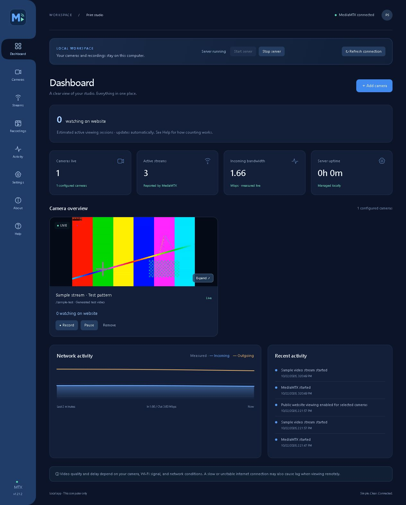

# MediaMTX Manager

A desktop and browser interface for MediaMTX, created by **MindVision Graphics**.
View cameras, record video, manage storage and back up your local camera workspace.

## No command-line installation required

**No CMD, PowerShell, Terminal, sudo commands, or manual package installs.**
The packaged apps include the components they need—no separate Node.js,
MediaMTX, FFmpeg, or package-manager installation is required.

- **Windows desktop:** open the setup EXE and follow the on-screen installer.
- **Windows web edition:** extract the complete ZIP and double-click Start Manager.vbs.
- **macOS:** extract the correct app ZIP and drag MediaMTX Manager.app into Applications.

These instructions apply to the packaged downloads. GitHub's **Code → Download ZIP**
contains developer source files and is not a ready-to-install app. Preview downloads
are provided on the [Releases page](https://github.com/MindVisionGraphics/MediaMTX-Manager/releases). The Mac previews are unsigned
and not notarized; macOS may display a security warning.

## Preview status

This project is in active development. This repository currently provides source
code, interface assets and packaging sources. Packaged previews are listed on the Releases page. GitHub's Download ZIP contains source, not a ready-to-install app.

| Edition or check | Status |
| --- | --- |
| Windows graphical desktop installation | Passed by the project owner |
| Quit manager / Start manager in the same desktop window | Passed by the project owner |
| Tapo camera playback, pause/resume and recording | Passed in earlier owner tests |
| Installed web shortcut | Awaiting owner confirmation |
| Windows update, uninstall/reinstall and data preservation | Passed owner tests with the 0.9.1 update-test installer on October 25, 2026 |
| macOS Intel — Monterey 12.1 | Core launch, camera, recording/playback, pause/resume and same-window Quit/Start passed owner tests |
| macOS Apple Silicon | Compatibility checks passed; hardware testing pending |
| Code signing / Mac notarization | Not completed |

The packaged Windows preview includes its required components and graphical
setup; end users do not need CMD, PowerShell or manual package installation.
The Mac preview also bundles its components and targets macOS 12.0 or later.
Keychain persistence and remaining Mac acceptance checks still need confirmation.

Platform notes: [Windows](platforms/windows/README.md) · [macOS](platforms/macos/README.md).
Packaged apps are separate, clearly named attachments on the Releases page.
Source-built FFmpeg includes its matching source and build records as a separate download.
The replacement passed native media tests on Windows, Intel Mac and Apple Silicon Mac,
and packaged backend checks for sample streaming, MP4 recording and Quit/Start.
On October 24, 2026, the owner also confirmed that the updated source-built
Windows installer and Intel Mac Monterey build work after the requested recheck.
Interactive Apple Silicon desktop testing remains pending.

## Features

- Live camera dashboard with individual pause and resume controls.
- Tapo Camera Account setup and compatible custom RTSP camera paths.
- Recording timers, MP4 playback/download and recurring recording schedules.
- Optional age-based cleanup, storage limits and free-space protection.
- Encrypted settings backup and restore; recordings are excluded from backups.
- Experimental RTMP/RTMPS forwarding controls.
- Connected-curve navigation, built-in FAQ and branded About page.

Camera and browser compatibility varies. External streaming-service forwarding
is experimental. This GUI does not claim tested support for every protocol
supported by MediaMTX itself.

## Screenshots

### Camera dashboard

Live camera controls, recording status and network activity in one workspace.

The dashboard screenshot uses synthetic sample video, not a private camera feed.

## Camera setup

For a compatible Tapo camera, create its local **Camera Account** in the Tapo app,
then enter its local network address and Camera Account credentials in Add camera.
This account is separate from your normal Tapo sign-in. Other compatible cameras
can use their manufacturer-provided RTSP path. H.264 is recommended for browser
viewing. Camera passwords, recordings and local configuration are not in this repo.

## Desktop and browser editions

Desktop and browser editions share the same local workspace. The manager normally
opens at http://127.0.0.1:17860/. Closing its window leaves the manager running;
Quit manager stops its worker and leaves Start manager available in the same window.

The public printing Watch page on MindVision Graphics' website is a separate,
custom integration built for that website. It is not a public Watch page supplied
as part of the general MediaMTX Manager product. Related integration source and
historical notes remain in this development repository and should not be read as
standard product features or setup requirements.

## Source and development

This source checkout excludes Node.js, Electron, MediaMTX and FFmpeg binaries.
It is not the complete end-user installation package. With compatible runtimes
provided in runtime/, developers can run `node launcher.mjs`.
See [the source guide](docs/SOURCE-GUIDE.md) and [packaging notes](packaging/README.txt).
The original packaging scripts use the project's local layout. The documented FFmpeg
build and preview repackaging workflows are under .github/workflows; repackaging
uses verified base app archives staged in a private release draft.

## A little hidden history 🏴‍☠️

The Mac edition has a hidden Easter egg from the developer. A little curiosity
might uncover the story behind getting it running. Can you find it?

## License and credits

Manager-authored code is provided under the [MIT license](LICENSE).
Bundled and vendored components retain their own licenses. See
[third-party notices](THIRD-PARTY-NOTICES.md); the MIT license does not relicense
FFmpeg, Chromium, hls.js or other dependencies.

Created by [MindVision Graphics](https://mindvisiongraphics.com/).
Independent project; not affiliated with MediaMTX, TP-Link or Tapo.
